# The making of SYN/ACK

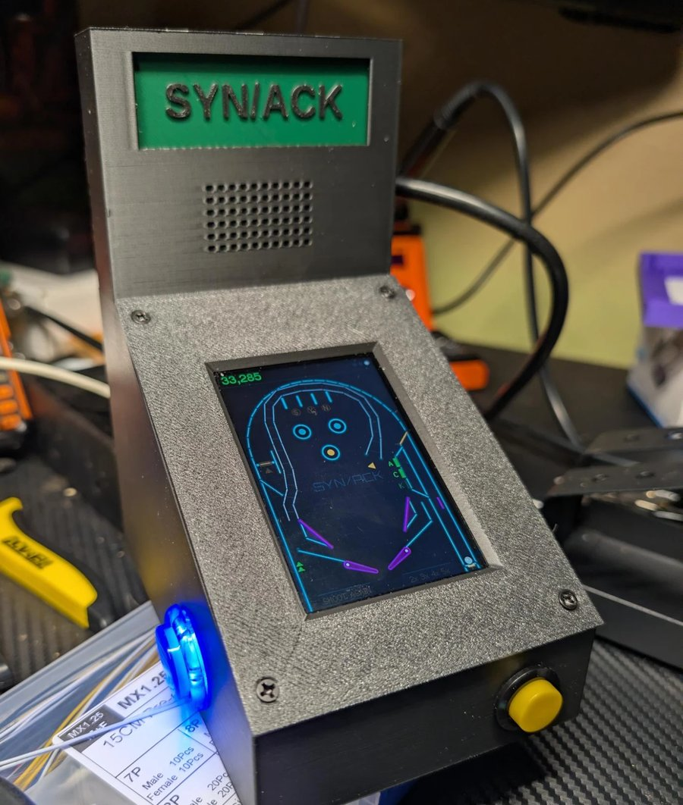

SYN/ACK is a pinball table for 3.5-inch ESP32 touch boards: a 320 × 480 neon
playfield where the lanes spell SYN, the targets spell ACK, and completing the
handshake floods the table with balls. It started on a Sunton "CYD", moved to an
ESP32-S3 board, and ended up in a printed tabletop cabinet with real arcade
buttons and a backbox. This is the story of how it got there, and the problems
worth remembering along the way.

## Two boards, one table

| | Sunton ESP32-3248S035R ("CYD") | LCDwiki ES3C35P |
|---|---|---|
| Chip | ESP32 | ESP32-S3, with PSRAM |
| Display | ST7796, SPI | ST77922, quad SPI |
| Touch | XPT2046, resistive, one point | capacitive, multi-touch |
| Sound | a buzzer on a PWM pin | ES8311 codec and amplifier |
| Lights | an RGB LED | an RGBW NeoPixel |

Both are 320 × 480 portrait, so the table itself never had to change. Everything
that does differ lives behind one small interface:

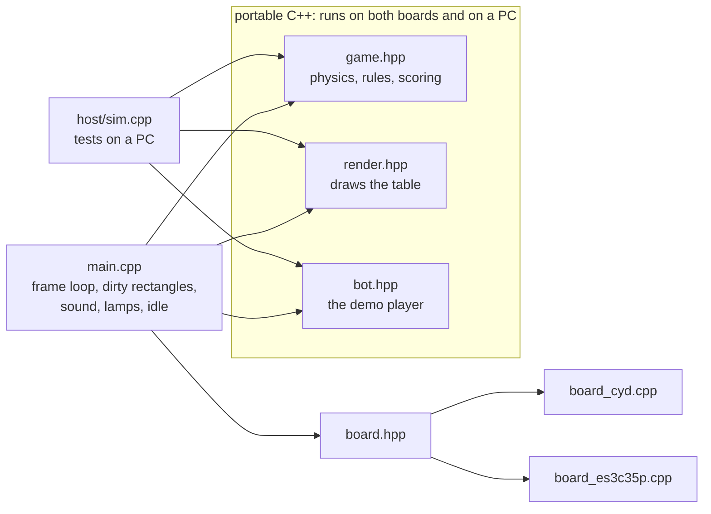

`game.hpp` is plain C++ with no Arduino in it, which turned out to be the most
important decision in the project: the same physics and rules compile into a
test program on a PC, where a bot can play hundreds of balls in seconds.

## The table

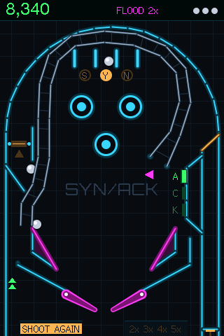 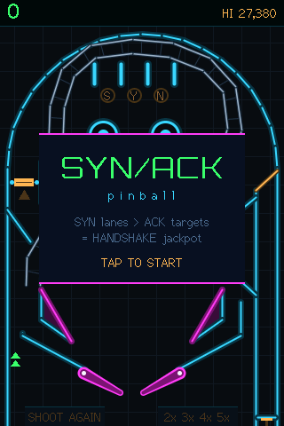 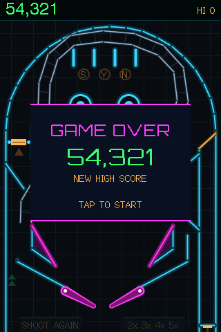

*Real screenshots, read back off the CYD's panel over serial.*

The theme is the TCP handshake:

- Lighting all three **SYN lanes** at the top raises the multiplier (up to 5×)
  and arms SYN.
- Knocking down all three **ACK targets** on the right scores 5,000, or a
  25,000 **HANDSHAKE** if SYN is armed, and relights the kickback.
- A HANDSHAKE starts **SYN FLOOD**: two more balls are plunged in and
  everything scores double. The second HANDSHAKE in a game also earns an extra
  ball.
- The **UPLINK ramp** climbs the right side, crosses over the top and drops the
  ball into the left inlane. It lights the next SYN lane, and during multiball
  it's a 15,000 jackpot.
- A **spinner** in the left orbit pays double while SYN is armed.
- A **skill shot** zone on the plunger's power meter, a kickback in the left
  outlane, a ball save, and an end-of-ball bonus count-up.

When nobody is playing, a bot plays a silent demo game with a light show, and
it never sets the high score.

## Physics: small steps and capsules

The ball moves in fixed steps of 1/600 of a second, however fast the screen
draws. Every wall, post, sling, target and flipper is either a circle or a
**capsule** (a line segment with a radius), so a single closest-point routine
handles every collision. Flippers carry their surface speed into the bounce,
which is what makes a flick feel like a flick.

Tuning was done by measurement more than by feel. The first players found the
flippers weak (their up speed went from 24 to 29 rad/s) and the outlanes greedy.
Narrowing the outlane gap did nothing, because it was already barely wider than
the ball; shortening the separator above it did. In a 600-ball bot run, outlane
drains fell from about 75% to 53%.

The ramp's exit is a good example of how small changes matter: angled slightly
left, it fed balls straight into the left outlane, and the average ball life
fell from 32 to 22 seconds. Pointed straight down, it feeds the flipper.

### The ball that slowed down

The most stubborn bug was a ball that sometimes crawled down to the flippers.
It had three separate causes:

1. **The ramp crawled.** A weak shot could take 3.5 seconds to come back down.
   The ramp now keeps a minimum speed past its crest.
2. **Slow motion.** When too many parts of the screen changed at once, the
   game fell back to redrawing everything, about 170 ms on the S3. The physics
   caps each frame's time step at 50 ms, so those frames played in slow motion.
   Now the extra changes are merged into the nearest existing rectangle.
3. **Rolling friction.** Each collision took a little speed off along the
   surface. But a ball *rolling* along a guide touches it on every step, 600
   times a second, so rolling was capped at about 50 px/s:

```cpp
// a touch of friction on real impacts only. A ball rolling along a
// guide or flipper "hits" it every substep as gravity presses it in, and
// braking each of those (600/s) capped rolling at ~50 px/s
if (vn < -60) {
  V tg = perp(n);
  rel = rel - tg * (dot(rel, tg) * 0.015f);
}
```

The roll down the inlane went from 2.6 seconds to 1.0, and a test now measures it.

### The kickback that didn't kick

The left outlane has a kickback: when it's lit, a ball falling down the
outlane is fired back up into play. The soak runs counted hundreds of
kickbacks firing, so it looked fine. But they counted the kick, not whether
it saved anything.

It didn't. The kickback fired the ball straight up, and right above the
outlane sits the exit wall of the left orbit, angled to throw balls coming
down the orbit back into play. A ball fired straight up hit that wall from
underneath and dropped back down the same outlane.

The bug turned up in Hack the Planet, a browser pinball game built on
SYN/ACK's physics, where players noticed it first. The fix is the same in
both: start the ball in the middle of the outlane, and partway up hook it to
the right, under the wall instead of into it. The hook is checked in every
physics step, so a slow frame can't carry the ball past it:

```cpp
if (b.kick) {  // checked every substep, so a slow frame can't skip it
  if (b.v.y > 0) b.kick = false;  // fell back without reaching the hook
  else if (b.p.y < KICK_HOOK_Y) {
    b.kick = false;
    b.v = {KICK_OUT_VX, fmaxf(b.v.y, -KICK_OUT_VY)};
  }
}
```

A test now drops a ball into the outlane from three positions and checks it
comes back into play. All three failed before the fix. Together with three
smaller fixes from the same round, the average ball life in a 600-ball bot run
went from 32.6 to 37.2 seconds, and left-outlane drains fell from 140 to 89.

## Drawing fast

Redrawing the whole 320 × 480 screen every frame is far too slow over SPI, so
the game tracks **dirty rectangles**: the ball's old and new position, a lamp
that changed, the score. Each frame merges the overlapping ones and redraws only
those, through two 320 × 48 DMA buffers so one is drawn while the other is
sent. That runs at around 89 frames a second on the CYD.

When the whole screen does need redrawing, it's spread over ten frames,
48 rows at a time, instead of stalling one frame for 170 ms. The worst frame
dropped to about 32 ms on the S3 and 35 ms on the CYD.

### The diagonal smear

The ES3C35P's first images came out sheared diagonally. The cause was in the
ST77922's datasheet: the start column and the width of a drawing window must
both be **multiples of 4**. Anything else is quietly misdrawn: each row lands a
few pixels off from the one before, so every update smears into a diagonal
staircase, worst wherever the ball has been.

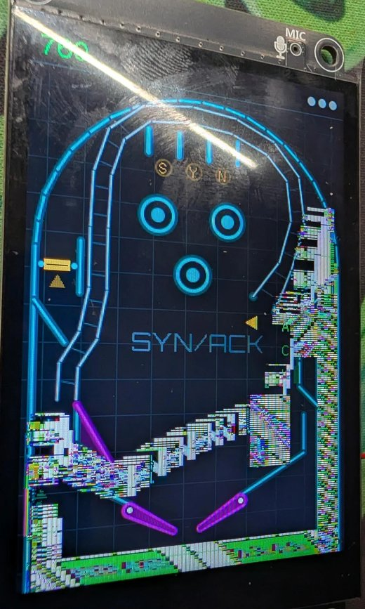

The fix is to widen every rectangle to the next 4-pixel boundary before
drawing:

```cpp
const int A = board::ALIGN_X;  // 4 on the ES3C35P, 1 on the CYD
for (int i = 0; i < n; i++) {
  int x0 = d[i].x / A * A;
  int x1 = min((d[i].x + d[i].w + A - 1) / A * A, (int)pb::SCR_W);
  d[i].x = x0;
  d[i].w = x1 - x0;
}
```

The board's own screenshot command couldn't show this bug, since it reads a
copy of the image in memory rather than the panel. Only a photo of the real
screen did.

## Sound

The CYD has a buzzer, so it plays one square-wave note at a time. The ES3C35P
has a real audio codec, so it gets a small synthesizer: three voices mixed
together, each a square, pulse, triangle, saw or noise wave that can sweep in
pitch and decay like a struck sound. Bumpers thump, the spinner ticks, the
flippers make a short noise burst when they hit the ball, and multiball gets an
arpeggio fanfare. On the CYD the same events play the first note of each sound.

## Testing without the hardware

`host/sim.cpp` builds the game for a PC (inside a Docker container with g++).
It:

- draws the table to image files,
- sweeps plunger strengths and flipper shots,
- lets the demo bot play 300 balls, failing if a ball escapes the table or a
  feature (multiball, the ramp, the lanes) never triggers,
- checks the rules one by one: multiball, the bonus count, the skill shot, the
  extra ball, and that the demo never sets the high score,
- and checks that redrawing only the dirty rectangles gives exactly the same
  pixels as a full redraw.

The long bot run found two places where the ball could get trapped (where the
inlane guide meets the flipper pivot, and under the slingshots) before any
person did. On GitHub, every push builds the firmware for all three targets
and runs the tests.

One detour worth mentioning: the ESP32's compiler crashed outright with an
internal error once the bonus code was inlined into the main game loop. Marking
those helpers "don't inline" was the fix.

## Real buttons

On the CYD, the flipper buttons go on the IO22 and IO21 pins of its extension
socket, and on the ES3C35P on its serial socket (IO43 and IO44, which are free
because the S3 talks to the PC over its own USB). On both, a launch button is
wired across the board's BOOT button: hold to charge the plunger, release to
fire.

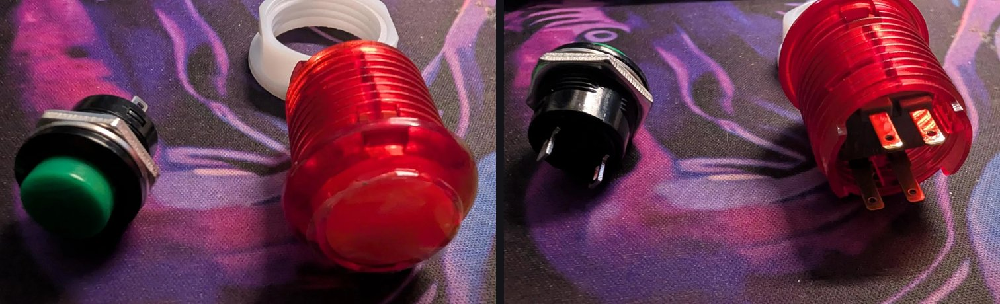

*Left, the launch button: a 16 mm push button with two tabs. Right, a flipper
button: a 24 mm arcade button with an LED inside, so four tabs. The two switch
tabs come off the microswitch body, and the two lamp tabs off the LED holder
behind it. Both buttons' tabs are 2.8 mm wide, so they take 2.8 mm (0.110")
female spade connectors. Any colours work.*

Three things to watch:

- **"1.25 mm" isn't one connector.** JST GH, MX1.25 and a few other families
  all use 1.25 mm pin spacing, and they don't mate with each other. The
  ES3C35P's sockets take **MX1.25**. It took two wrong kits to find that out;
  a kit of pre-crimped MX1.25 leads is what finally fit.

  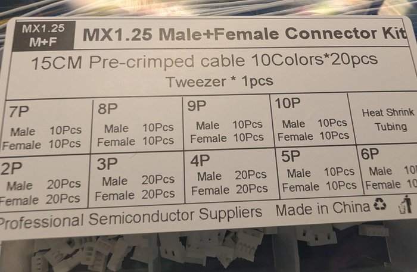

- The ES3C35P's serial socket has **5 V on pin 1** (marked with a small triangle
  and printed `5V`). Ground is pin 2. Read the labels printed on the board, not
  a guess from the schematic.
- The flipper buttons in the cabinet have 5 V LEDs, lit by the game on IO45 and
  IO46. Those two pins decide how the chip starts up, so each lamp is switched
  by a transistor, which keeps the pin low while the board boots.

## The cabinet

### Concepts

Three ideas were drawn up around the board's real dimensions:

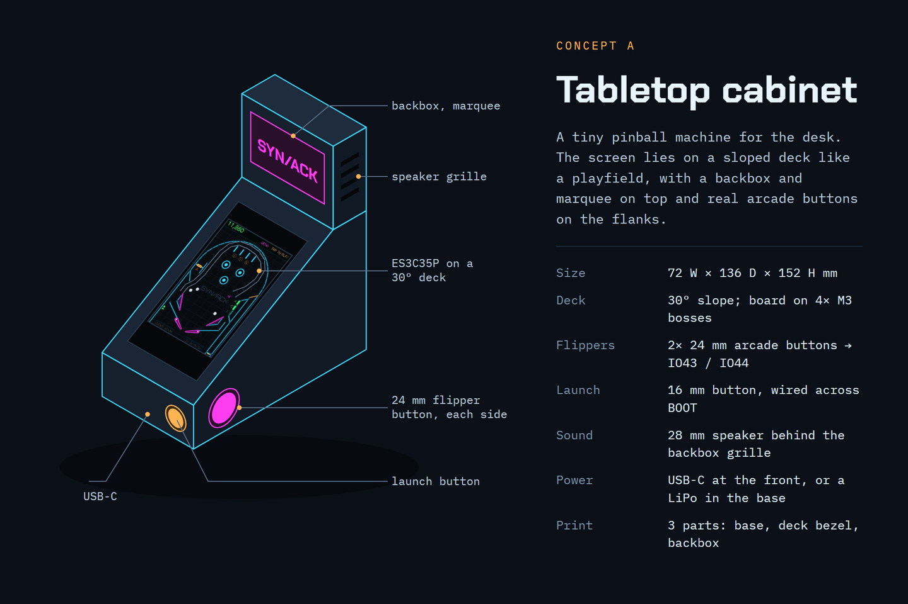

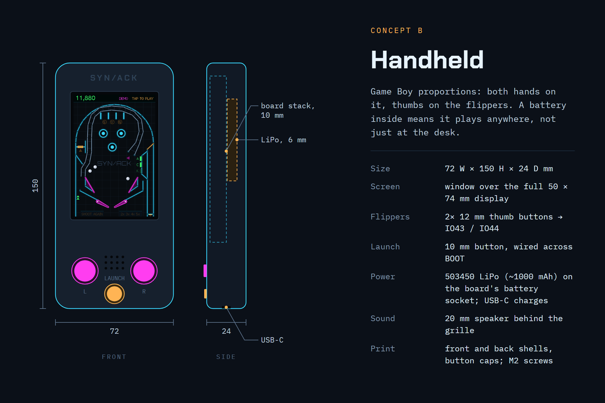

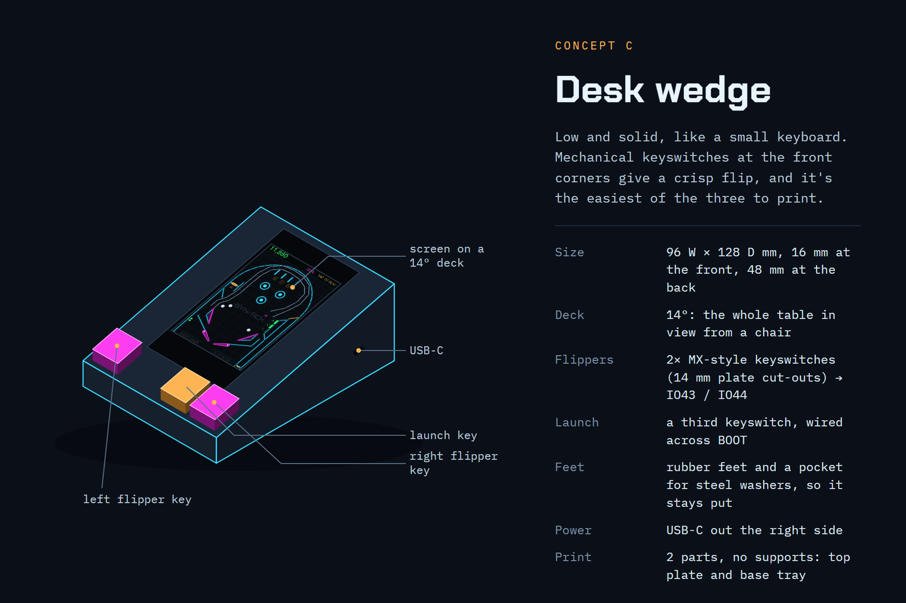

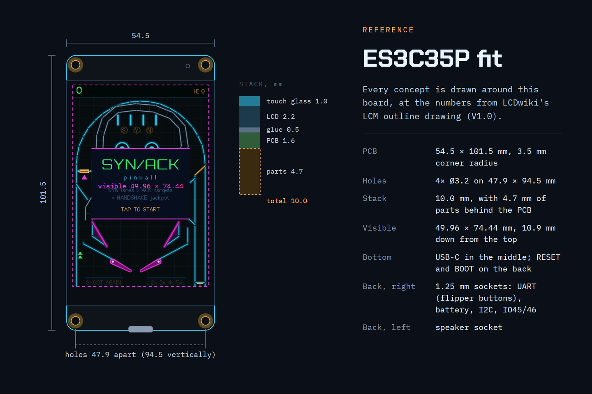

The tabletop cabinet won: it looks like a pinball machine, it has room for a
proper speaker, and the arcade buttons sit where real flipper buttons do.

### From concept to model

The case is one OpenSCAD file (`case/cabinet.scad`), driven by measurements:
the board's outline drawing, the buttons' datasheet, the speaker as measured.
Changing a number reshapes every part that depends on it.

The concept was 72 mm wide. The real 24 mm arcade buttons stick out about
41 mm behind the side wall once their connectors are on, and the two face each
other, so the cabinet grew to 92 mm. The model checks this itself: rendering it
prints the gap between the two buttons' connectors, and fails if any
clearance goes negative.

A "clash" render checks the hardware against the printed parts: the USB plug
and socket, the speaker and the marquee card, both in place and along the path
each takes to get there. It has to come out empty.

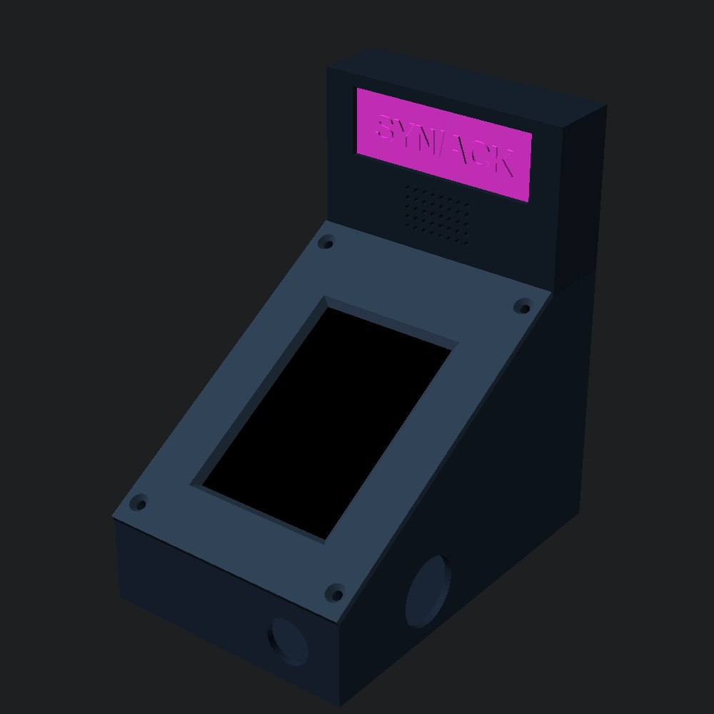 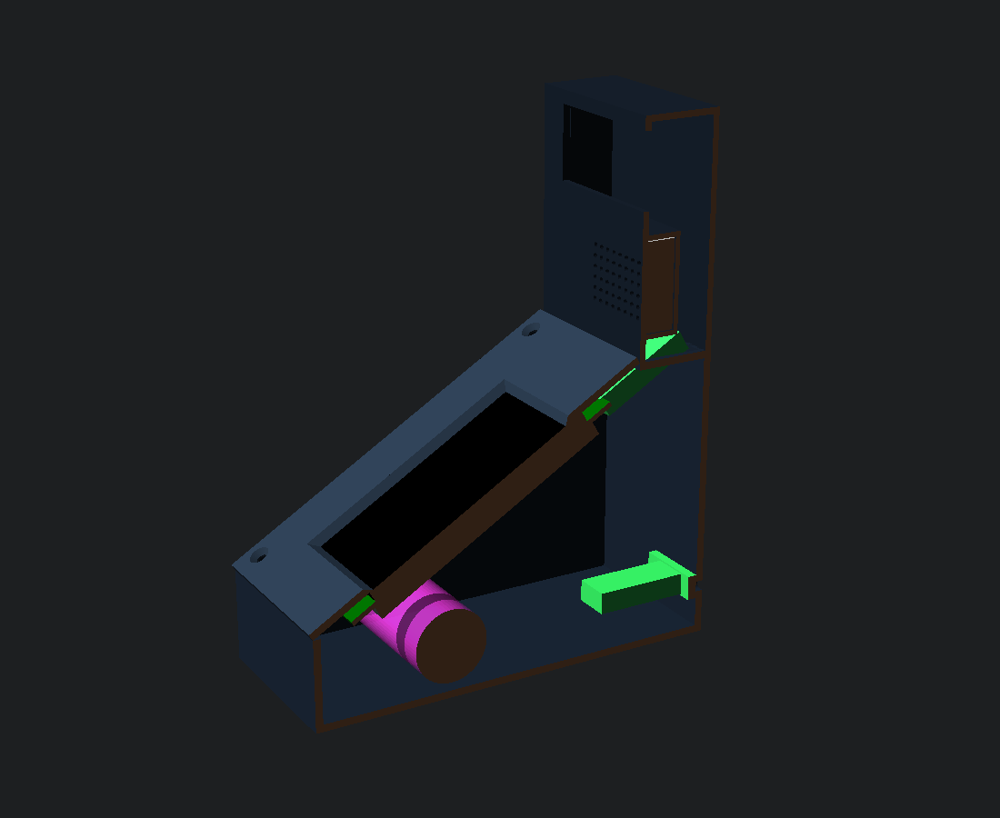

### Turning the board upside down

The ES3C35P has its USB-C, RESET and BOOT at one end. Mounted the obvious way,
the USB would face the player. Mounted upside down, it faces the back of the
cabinet and its sockets land nearer the buttons and the speaker. The
`es3c35p-cabinet` build turns the picture and the touch 180° to match. Since a
rectangle turned half a turn is just its pixels in reverse order at the mirrored
position, that's a few lines in the board layer and nothing anywhere else.

### Getting the USB out the back

A panel-mount USB-C socket sits in the back wall, with a short extension to the
board. With a straight plug, the cable had to double back hard inside the
backbox. A small 90° adapter on the board's port turns the plug down toward the
back wall instead, and the cable then reaches the socket in one loose loop:

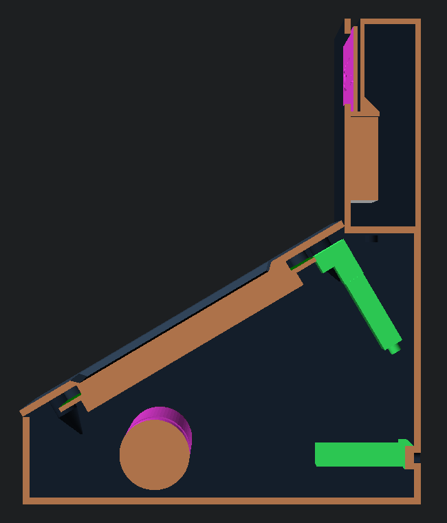

### Printing it

- **Four parts:** body, deck, backbox and marquee card, none needing supports.
- **The backbox prints upside down.** An open-bottomed box has a roof in every
  other orientation; this way every wall rises straight from the bed. The only
  bridge left is the top of the marquee window.
- **The speaker** (40 × 28 × 9 mm) slides up into the backbox from below,
  against the grille, until it stops under a shelf.
- **The marquee card** drops in through a slot in the top and stands on that
  shelf. Its letters are raised 0.8 mm, so the slot needs room for them: the
  first fit was too tight to print. Black letters on a black card vanished;
  printed in green with black letters, it reads from across the room.

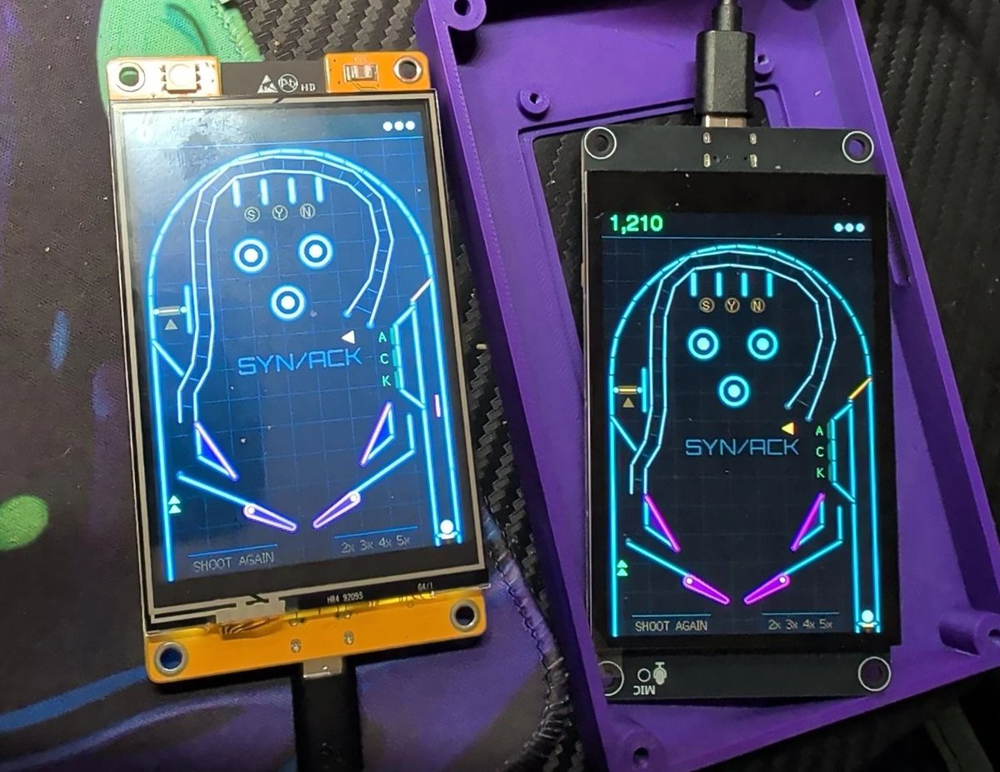

## What it taught

- **Keep the game portable.** Being able to run the real physics on a PC paid
  for itself many times: tuning, soak tests, and catching traps no human had
  found.
- **Measure, then change one thing.** The outlanes, the ramp exit and the slow
  ball were all settled by numbers from bot runs, not by feel.
- **Count outcomes, not triggers.** The kickback "fired" hundreds of times in
  testing while saving almost nothing. A test of what happens next caught it.
- **Per-contact effects must ignore resting contact.** Anything applied "on
  every collision" also runs 600 times a second on a ball that's just rolling.
- **Read the datasheet's fine print.** The 4-pixel rule and the 5 V pin were
  both written down. They just weren't where anyone looked first.
- **Name the connector family, not just the pitch.** "1.25 mm" fits three
  different plugs, and only one of them fits the board.
- **Check how parts go in, not only where they end up.** A model can fit
  perfectly once assembled and still be impossible to assemble.
- **Photos beat screenshots** for anything the panel itself gets wrong.
